# X9 Phantom

A custom launcher and a set of emulators for the **X9 Black Hawk** handheld (Allwinner F1C100s/F1C200s, Melis OS).
Built by **gremlin247** with Claude. Firmware version 1.2.0.1.

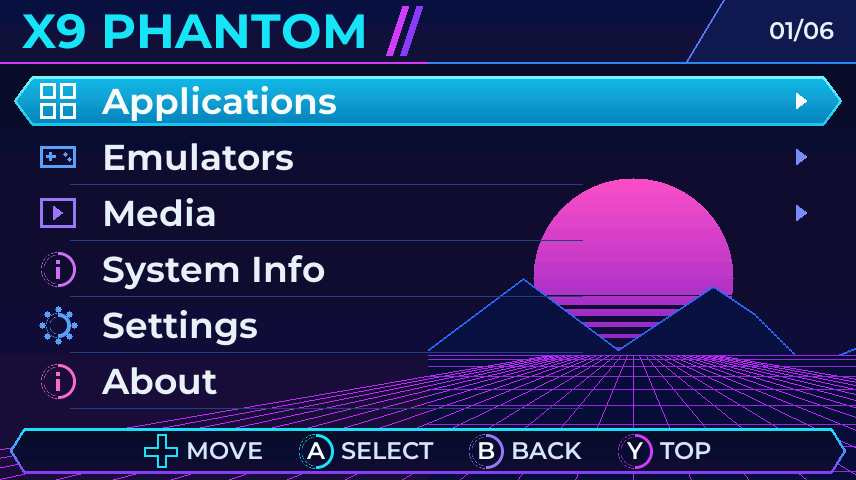

## What's in it

- **X9 Phantom launcher** (`home.axf`): a neon synthwave menu with smooth text, categories (Applications, Emulators, Media), System Info, Settings and About. It also has a volume bar, menu click sounds and a working power switch.
- **Our own game list for every emulator**: one consistent list with folders, using the same look everywhere.
- **Six emulators of our own**, plus the X9's seven stock emulators, all started from the launcher.
- **Everything in one SD restore zip**: [`release/X9_Phantom_SD_Restore_v1.zip`](release/X9_Phantom_SD_Restore_v1.zip).

## Emulators

| # | System | Emulator | Games folder | File types | Status |
|---|--------|----------|--------------|------------|--------|
| 1 | NES | X9 stock | `GAME\FC` | .nes | ✅ Working |
| 2 | SNES | X9 stock | `GAME\SFC` | .smc .sfc | ✅ Working |
| 3 | Mega Drive / Genesis | X9 stock | `GAME\MD` | .md .bin .gen .smd | ✅ Working |
| 4 | Game Boy | X9 stock | `GAME\GB` | .gb | ✅ Working |
| 5 | Game Boy Color | X9 stock | `GAME\GBC` | .gbc .gb | ✅ Working |
| 6 | Game Boy Advance | X9 stock | `GAME\GBA` | .gba | ✅ Working |
| 7 | MAME (arcade) | X9 stock | `GAME\MAME` | .zip | ✅ Working |
| 8 | Sega Master System | PicoDrive | `GAME\SMS` | .sms | ✅ Working |
| 9 | Doom | doomgeneric | `GAME\DOOM` | .wad | ✅ Working (sound effects, no music) |
| 10 | Commodore Amiga | UAE4ALL | `GAME\AMIGA` | .adf (needs `kick.rom`) | ✅ Working (best with lighter games) |
| 11 | ZX Spectrum 48K/128K/+2 | Fuse | `GAME\ZX` | .tap .tzx .z80 .sna .szx .zip … | ✅ Working |
| 12 | Atari 2600 | z26 | `GAME\A2600` | .a26 .bin .rom | ✅ Working (no paddles yet) |
| 13 | Commodore 64 | Teensy64 + reSID | `GAME\C64` | .prg .d64 .t64 .crt | 🚧 **Work in progress** |

**Commodore 64 status:** it boots, runs simple programs, and loads .prg/.d64/.t64 files through the normal LOAD. Cartridges start and show their title screen. Robocop 2 (Ocean cartridge) doesn't get past its title screen yet. Fast loaders, second disks and saving aren't supported yet.

## Controls

These are the letters printed on the X9.

**Launcher:** D-pad moves, **A** selects, **B** goes back, **Y** jumps to the top. The volume rocker shows the volume bar.

**Our emulators (8–13)** share these controls:
- **Select:** change the screen mode (full screen, zoomed, or sharp 2× with the controls shown beside the picture).
- **Hold A+B:** go back to the game list.
- **B** on the game list goes back to the launcher.
- Each one has a settings file `GAME\<folder>\x9_<name>.cfg`. In it, `log=1` turns on a log for troubleshooting, `screen=` picks the starting screen mode, and `sound=0` turns sound off.

| Emulator | A | B | Y | X |
|----------|---|---|---|---|
| Master System | button 1 | button 2 | Pause | |
| Doom | fire | use / open | menu | + D-pad: strafe, change weapon |
| Amiga | fire | | | |
| ZX Spectrum | fire | | Enter (+ D-pad: keys 1–4) | |
| Atari 2600 | fire | console Reset | console Select | tap: difficulty, + Up: colour/B&W |
| Commodore 64 | fire | Space | F1 | + Up Run/Stop, + Down Return, + L/R Y/N, + A/B 1/2; tap: joystick port |

## Screenshots

| | |
|---|---|
| 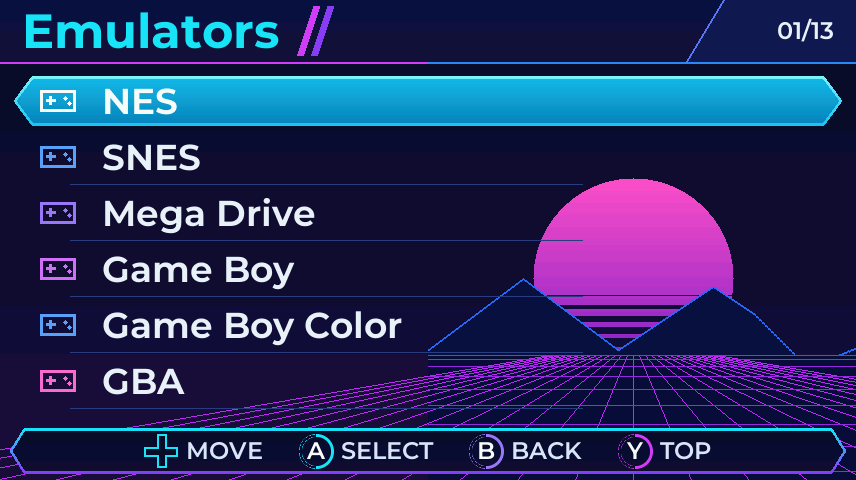 | 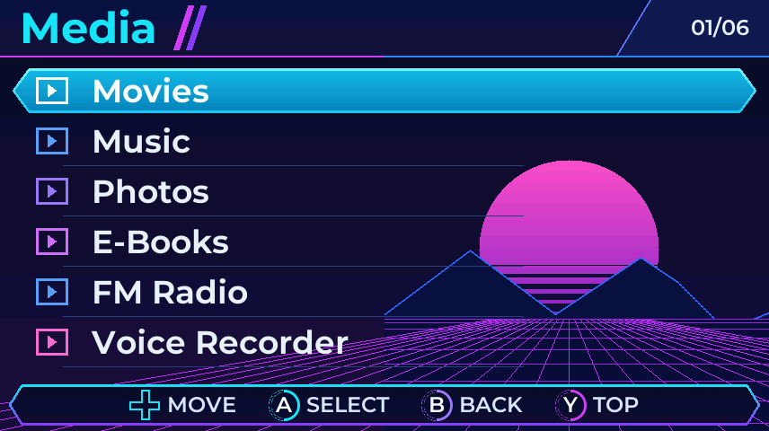 |
| 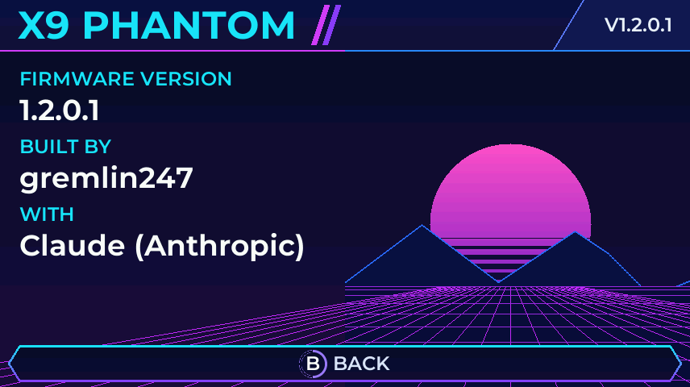 | 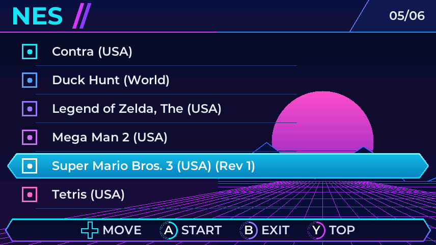 |
| 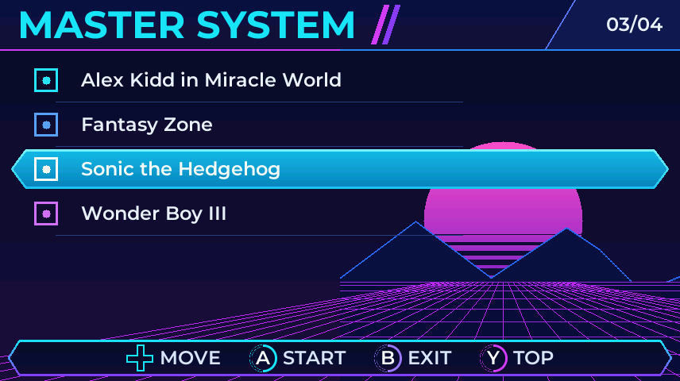 | 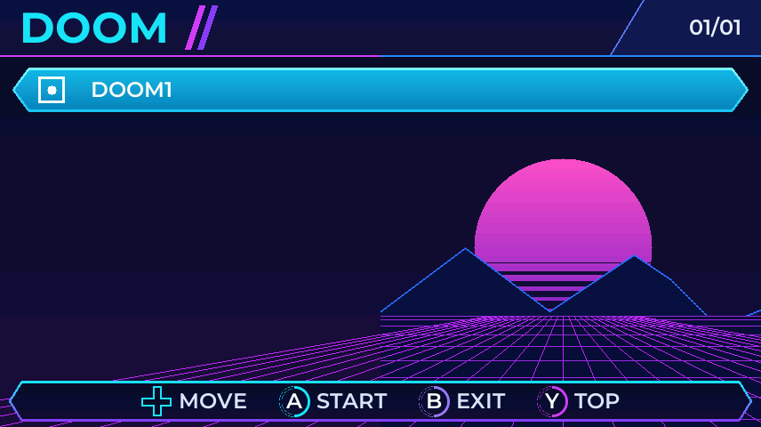 |
| 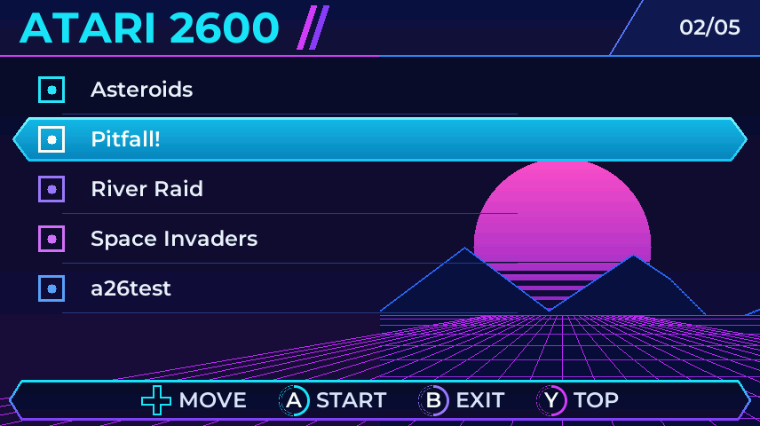 | 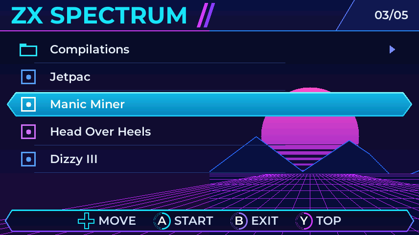 |
| 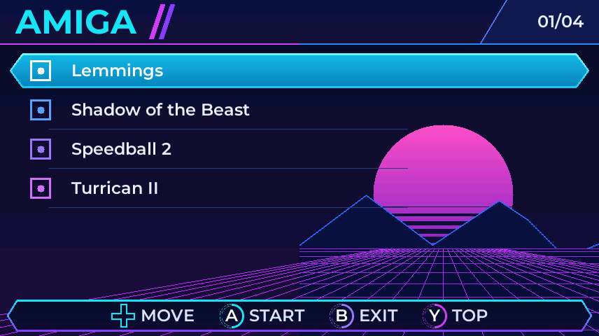 | 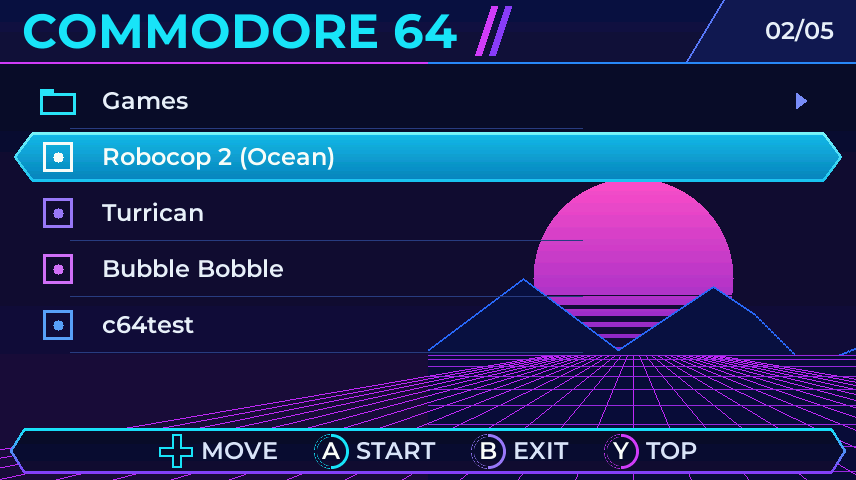 |

The game names in the screenshots are only examples. No games are included.

## Installing

Download [`release/X9_Phantom_SD_Restore_v1.zip`](release/X9_Phantom_SD_Restore_v1.zip) and unzip it. On your PC the X9's card shows up as two drives: the **system** partition (E: in these steps) and the **games** partition (F:).

**Update an existing card**
1. On E:, delete everything inside `Menu\Emulators` (the old entries).
2. Copy the zip's `D\` folder contents over E: and say yes to replace.
3. Copy the zip's `E\GAME` folder over `F:\GAME`. This adds the new folders.
4. Eject safely and reboot.

**Fresh card:** put the original firmware file system on the card first, from your own SD image. Then copy `D\` to E: and `E\` to F:.

**Files you supply:**
- your games, ROM files and saves;
- `DOOM1.WAD`;
- the Amiga `kick.rom`;
- the C64's `kernal.rom`, `basic.rom` and `chargen.rom`.

The zip's `README.txt` has the full details, and `SHA256SUMS.txt` lets you check the files.

## Source and credits

The zip's `source\` folder has the full source of the launcher and every emulator build. Our emulators are built on these open-source projects, under their own licences:
- [Fuse](https://fuse-emulator.sourceforge.net/) (ZX Spectrum, GPL)
- [PicoDrive](https://github.com/notaz/picodrive) (Master System)
- UAE4ALL rev 1.2, MiyooCFW version (Amiga, GPL)
- [z26](https://github.com/aksommerville/akz26) (Atari 2600, GPL v2)
- [Teensy64](https://github.com/FrankBoesing/Teensy64) and [reSID](https://github.com/FrankBoesing/Teensy-reSID) (C64, GPL)
- [doomgeneric](https://github.com/ozkl/doomgeneric) (Doom, GPL v2)
- [Montserrat](https://github.com/JulietaUla/Montserrat) font (SIL OFL 1.1)

The X9's stock emulators, the File Browser (`explorer.axf`, `theme.bin`, skins) and the original firmware belong to the device maker. Only the File Browser files and our patched `desktop.mod` are included, so the custom menu works.
